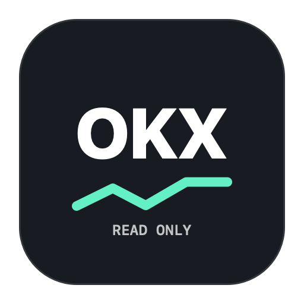
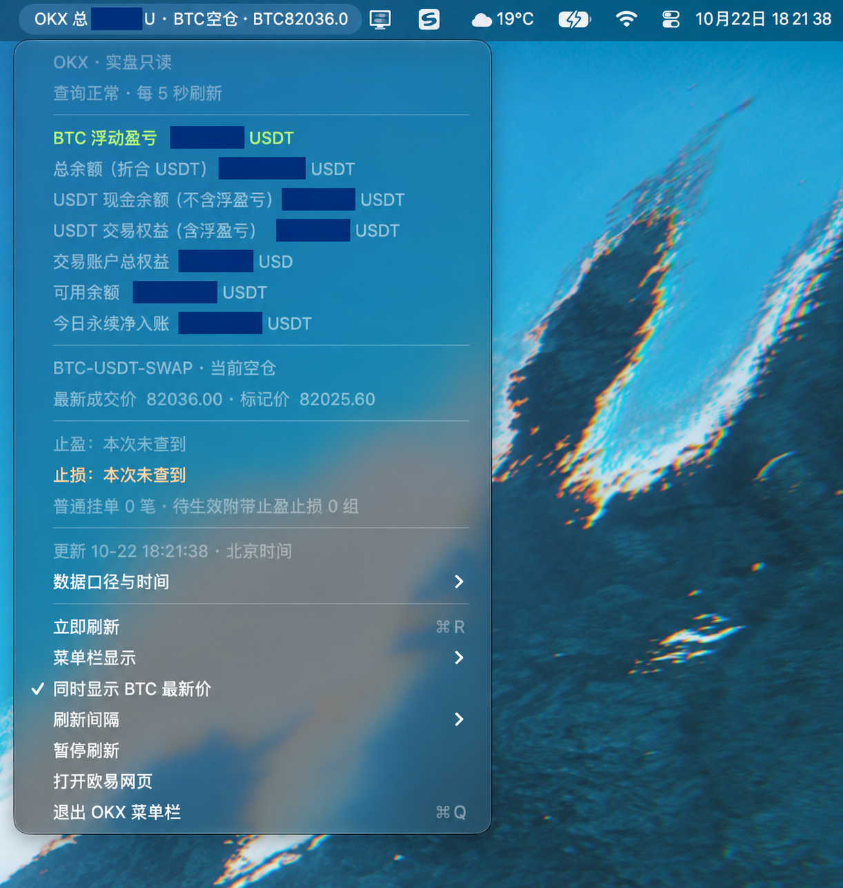

# OKX ReadOnly Menu Bar



在 Mac 顶部状态栏查看 OKX 总资产、BTC 永续浮盈亏和最新价格。原生 AppKit 界面，账户始终只读。

**这是个人开发的非官方客户端，与 OKX 无隶属关系。** 数据通过 [OKX 官方 Agent Trade Kit](https://github.com/okx/agent-trade-kit) 获取；不是交易机器人，不提供收益承诺或投资建议。

## 界面预览



**上图来自实际运行界面，经 AI 图片编辑工具做金额脱敏处理，部分像素可能重绘，界面细节以应用为准。** 保留 macOS 原生半透明菜单样式；黑蓝色遮挡块隐藏账户金额。图中价格与时间仅属于截图当时，不代表实时行情。点击顶部状态栏可展开余额、持仓、止盈止损和刷新设置。

## 能显示什么

- 总资产：直接使用 OKX 资产估值接口的 `totalBal`，折合 USDT，包含浮盈亏，不重复相加。
- BTC-USDT-SWAP：最新价、标记价、方向、张数、BTC 数量、均价、杠杆、全仓/逐仓、浮盈亏、收益率、预估强平价。
- BTC 永续普通委托、条件/OCO/移动止损，以及附带止盈止损。
- 下拉菜单区分 USDT 现金余额、交易权益、可用余额及当日账单净额。
- 默认约每 5 秒发起刷新，可改为 10/15/30/60 秒或暂停。网络耗时会影响实际完成间隔。
- 查询失败、过期或暂停时隐藏金融数值，避免把缓存当实时行情。
- 只运行一个实例。无 Dock 运行标记；可将应用拖到 Dock 固定，运行后看顶部状态栏。

当日账单按北京时间零点统计，仅包含 SWAP/USDT 账单，排除划转和未实现盈亏，不能直接当作整个账户的收益率或税务报表。委托查询重点覆盖 BTC 永续；未覆盖所有计划开仓委托类型。

## 安装与构建

需要 macOS 13+、Xcode Command Line Tools、Python 3.9+、Node.js 20+ 和 npm。构建依赖安装在项目目录，不改 Codex 的 MCP 配置。

```bash
xcode-select --install
git clone https://github.com/Rayemmmm/okx-menubar.git
cd okx-menubar
python3 scripts/build.py
```

生成 `build/OKX ReadOnly.app`，包含当前机器架构的 Node.js 和锁定版本的 MCP 依赖。构建脚本会运行应用自身的数据新鲜度检查，并做本地 ad-hoc 签名。**未做 Apple Developer ID 签名和公证，没有通用架构安装包。**

可用 `python3 scripts/build.py --node /absolute/path/to/node` 指定 Node。不要从不可信来源复制 Node 或安装依赖。

把 `.app` 拖到“应用程序”目录；可拖到 Dock 固定，然后双击启动。应用只出现在顶部状态栏，点击可展开详细菜单。

## 本机私密配置

1. 在 OKX 创建 API，**只勾选 Read/读取**，不要启用 Trade 或 Withdraw。
2. 在本机 Terminal 运行：

   ```bash
   python3 scripts/setup_private.py
   ```

   API Key、Secret 和 Passphrase 均隐藏输入。保存到当前用户的 `~/.okx/config.toml`，目录权限 0700，文件权限 0600。脚本不会覆盖或读取已有配置；已有配置请在本机编辑器自行检查，不要把文件发到 issue、聊天或 Git。

3. 本项目使用 `codex-readonly` profile。已有配置需要包含该 profile，匹配你的真实站点，使用实盘只读 API。具体配置格式参见 [官方文档](https://app.okx.com/docs-v5/agent_en/)。

应用每次查询验证 API 的权限恰为 `read_only`，以及服务器 `readOnly=true`、`demo=false`；不满足时不显示账户数据。没有任何“测试交易”。

## 凭据与隐私

- 自有代码只检查凭据文件的元数据；只有官方 MCP 包读取配置并向 OKX 完成鉴权。
- 启动固定使用 `--read-only --no-log --live`，并移除继承的 `OKX_*`、调试及 Node 启动覆盖变量。
- MCP 子进程的原始 stderr 被抑制，避免上游配置解析错误把凭据行写入日志。
- 金融数值仅保留在进程内存；可选诊断只记录进程、刷新时间和状态，不记录余额或密钥。
- 没有遥测、自动交易、后台交易通知或开机启动服务。
- 含一个进程级 DNS 备用解析器：仅在指定公开主机的系统 DNS 查询失败时，通过 Cloudflare DNS-over-HTTPS 解析主机名，不传输 API 凭据，也不关闭 TLS 验证。
- 请勿公开带账户金额、订单号或个人信息的截图；报告问题时只提供去敏后的错误状态。

## 项目结构

```text
Sources/main.swift                  原生状态栏界面、刷新和过期检测
Resources/snapshot.mjs              固定只读查询与字段整理
Resources/launch.cjs                官方 MCP 安全启动入口
Resources/dns-fallback.cjs          进程内备用 DNS
Resources/runtime/package*.json     官方依赖版本和完整锁文件
scripts/build.py                   可重复构建
scripts/make-icon.swift             图标生成
scripts/setup_private.py            Terminal 私密输入
```

源码采用 MIT License；Node.js 和 npm 依赖遵循各自许可证。向他人分发构建产物前应保留其许可证与通知。首版在 Apple Silicon Mac 上完成构建和真实只读查询验收；其他设备、地区和账户模式仍需验证。

---

## English

A native macOS menu-bar app for OKX total asset valuation (USDT), BTC perpetual P&L and price. Powered by the official OKX Agent Trade Kit in enforced read-only live mode. Not affiliated with OKX; no order placement, transfers, telemetry, or credential uploads.

Build from source with `python3 scripts/build.py` on macOS, then configure a Read-only API privately using `python3 scripts/setup_private.py`. Never paste API secrets into GitHub issues. Source code is MIT licensed; dependencies retain their own licenses. Builds are local and ad-hoc signed, not notarized.
